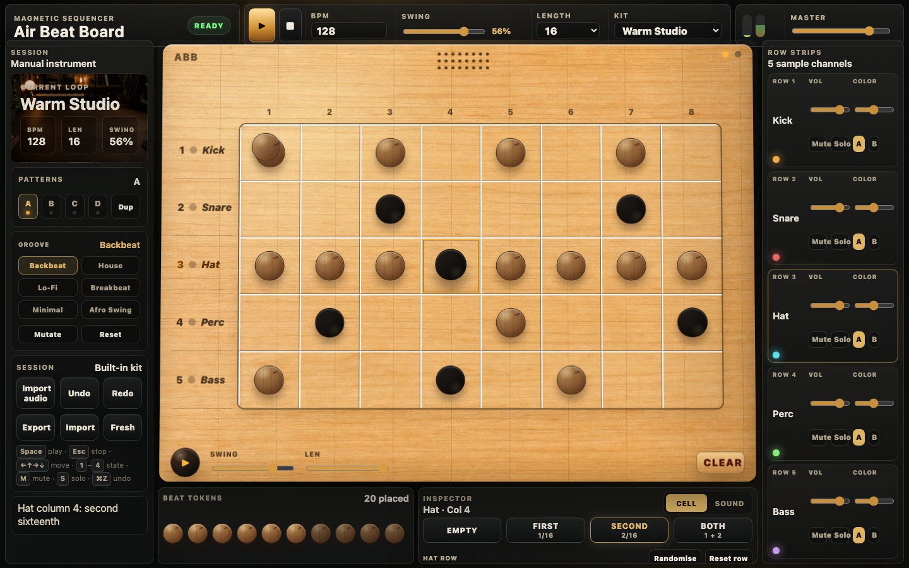
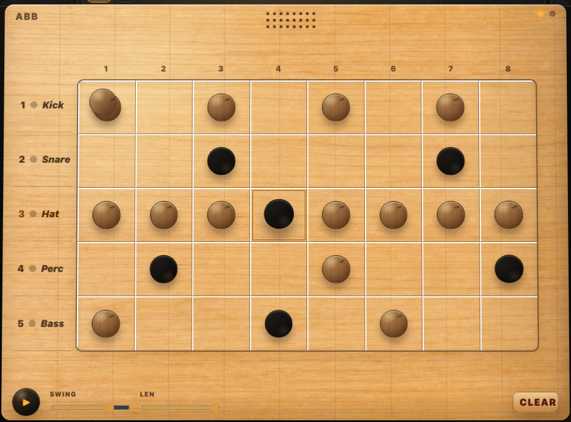
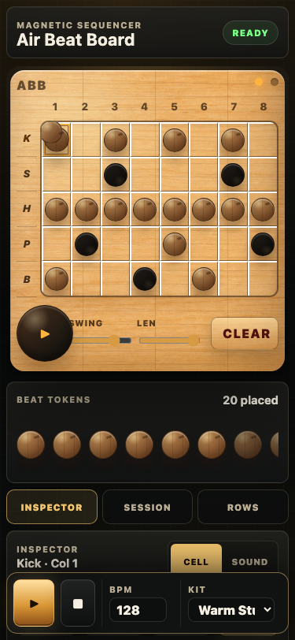

# Air Beat Board

Air Beat Board is a browser-based musical instrument built around a tactile 5-row by 8-column sequencer. It turns a wooden tabletop-style board into a playable rhythm and sample device with procedural sounds, local sample import, and row controls.

The app is deliberately static: no framework, no package manager, no build step. Open it from a local web server and it runs in the browser.

## Screenshots







## What It Does

- Creates a 5-channel beat board with 8 visible columns.
- Expands each visible column into 2 sixteenth-note sub-steps, producing a 16-step loop.
- Lets each cell be empty, first sub-step, second sub-step, or both sub-steps.
- Plays a built-in procedural kit using WebAudio.
- Supports local audio sample import with `decodeAudioData`.
- Provides per-row controls for volume, pitch, effect send, mute, solo, choke, and A/B sample slot selection.
- Provides global controls for play/stop, BPM, swing, loop length, kit, and master level.
- Ships six groove templates (Backbeat, House, Lo-Fi, Breakbeat, Minimal, Afro Swing) with Mutate, per-row Randomise and Reset.
- Full undo/redo across the board, row settings and globals, plus keyboard shortcuts.
- Autosaves the session to the browser, restores it on the next visit, and exports/imports it as JSON.
- Four pattern slots (A to D) with duplicate and launch-on-next-bar switching.
- Supports mouse and touch as the primary interaction model.

## Interaction Model

The board has 5 rows and 8 columns.

- Rows are sound channels: Kick, Snare, Hat, Perc, and Bass.
- Columns are time positions.
- Each column contains two internal sixteenth-note steps.

Cell states:

| State | Visual | Playback |
| --- | --- | --- |
| Empty | No token | Silent |
| First | Brown token | Plays the first sixteenth in that column |
| Second | Dark token | Plays the second sixteenth in that column |
| Both | Stacked token | Plays both sixteenths in that column |

Click or tap a cell to cycle:

```text
empty -> first -> second -> both -> empty
```

You can also select a cell and use the Cell State buttons to set the state directly.

Drag a token (from the tray or another cell) to move it; a press that moves less than 6px is a click, so tapping a token still cycles the cell. Dropping a token onto a filled cell stacks it into "both".

Keyboard:

| Key | Action |
| --- | --- |
| Space / Esc | Play or pause / stop and reset |
| Arrow keys | Move the selected cell |
| 1 2 3 4 | Set the selected cell to empty, first, second, both |
| Backspace | Clear the selected cell |
| M / S | Mute / solo the selected row |
| Cmd/Ctrl+Z, Shift+Cmd/Ctrl+Z | Undo / redo |

Grooves, pattern slots and the session live in the left panel: pick a groove to replace the board (undoable), Mutate to nudge it, Dup to copy the live board into the next free slot, and pick a slot while playing to launch it on the next bar. The session autosaves; Export and Import move it between browsers as JSON.

## Audio Engine

Air Beat Board uses WebAudio directly.

The audio engine includes:

- Lookahead sequencer scheduling.
- 16-step playback derived from the 5×8 board.
- Procedural kick, snare, hat, percussion, and bass voices.
- Built-in kit variations.
- Per-row volume.
- Per-row pitch.
- Per-row send into a delay-style effect return.
- Master output level with an analyser-driven meter and per-row hit flashes.
- Local sample import for replacing row A/B slots.

Audio starts only after a user action, such as pressing play, so it follows browser autoplay rules.

## Running Locally

From this directory:

```sh
python3 -m http.server 4174
```

Then open:

```text
http://localhost:4174/
```

A local server is required because the app loads JavaScript modules and uses browser APIs that work reliably from `localhost`.

## Browser Requirements

Recommended:

- A recent Chromium-based browser, Safari, or Firefox.
- Speakers or headphones.

## File Structure

```text
.
├── index.html
├── css/
│   ├── base.css      tokens, reset, app shell, top bar, transport
│   ├── board.css     the wooden board, grid, cells, tokens, playhead
│   ├── panels.css    session panel, tray, inspector, channel strips
│   └── responsive.css breakpoints and motion preferences
├── app.js            entry: DOM refs, wiring, meter loop
├── state.js          store, constants, notify/subscribe
├── actions.js        every user-level operation (the only state writers)
├── history.js        undo/redo snapshots
├── grooves.js        groove templates, mutate, randomise, pattern codec
├── storage.js        autosave, JSON export/import
├── audio/
│   ├── engine.js     AudioContext, master bus, lookahead scheduler
│   ├── voices.js     procedural voices and sample playback
│   └── kits.js       kit names and voicing tweaks
├── ui/
│   ├── board.js      grid, row labels, tray, drag and drop, playhead
│   ├── panels.js     transport, session, inspector, channel strips
│   └── keyboard.js   shortcuts and roving focus
└── assets/
    ├── maple-panel.png
    └── studio-desk.png
```

## V1 Scope

Included in this version:

- Static browser app.
- Warm wooden board interface.
- Mouse and touch composition.
- Procedural built-in kit.
- Local sample import.
- Per-row channel controls.
- Responsive desktop, tablet and phone layouts: on phones the board comes first, the transport docks to the bottom, and Session, Inspector and Rows live in drawer tabs.

Not included in this version:

- Live microphone recording.
- Account system.
- Cloud sample library.
- MIDI output.
- DAW plugin integration.

## Development Notes

The app has no install or build step. The test tooling is the only thing
`npm install` brings in.

```sh
npm install
npm run check      # node --check on every app module
npm test           # Vitest unit tests (state, grooves, history, storage, actions)
npm run test:e2e   # Playwright smoke test and axe accessibility audit
```

Two helper scripts exist for stylesheet work: `scripts/style-snapshot.mjs`
records the computed style of every element at three widths, and
`scripts/style-diff.mjs` compares two recordings, so a CSS refactor can be
proven not to change the rendered result. `scripts/screenshots.mjs` retakes
the README images.

The first `test:e2e` run needs `npx playwright install chromium`. The same
three commands run in GitHub Actions on every push and pull request.

Manual browser checks:

- Load the app over `localhost`.
- Press play (or Space) and confirm audio starts and the playhead sweeps.
- Click a cell four times and confirm it cycles empty, first, second, both.
- Drag a tray token onto a cell, and a cell token onto another cell.
- Change BPM, swing, length, kit, master level, and the row controls.
- Load a groove, mutate it, undo, redo.
- Switch pattern slots while playing and confirm the change lands on the bar.
- Import a local audio file and assign it to a row slot.
- Reload: the session comes back. Export, Fresh, Import: it comes back again.
- Check the phone layout: board first, bottom transport, drawer tabs.

## Privacy

Audio files imported into the app stay local to the browser session. The app does not include any server-side upload path. The autosaved session lives in this browser's `localStorage` and records only sample file names, never the audio itself.

## License

No license has been selected yet. Treat the code and assets as private unless a license is added by the repository owner.
